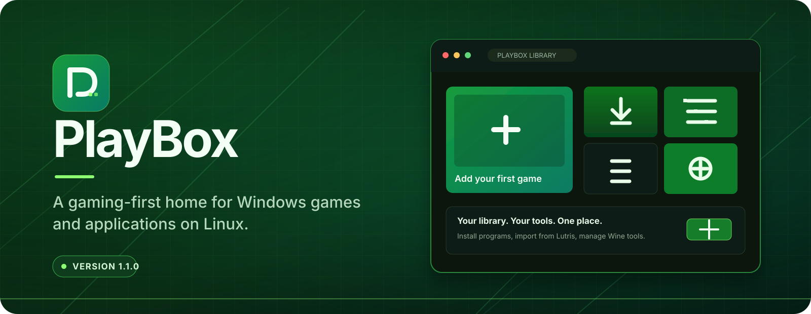
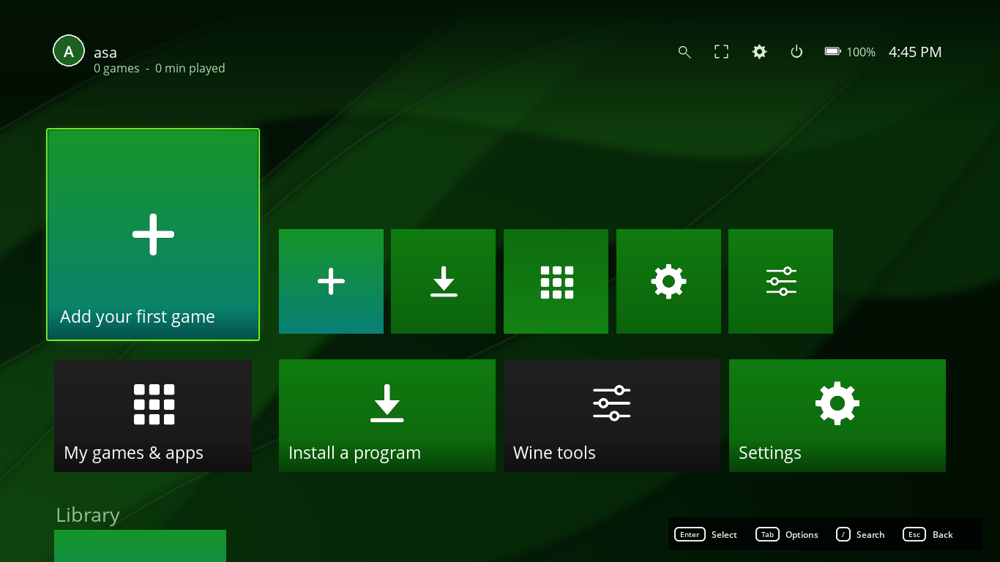
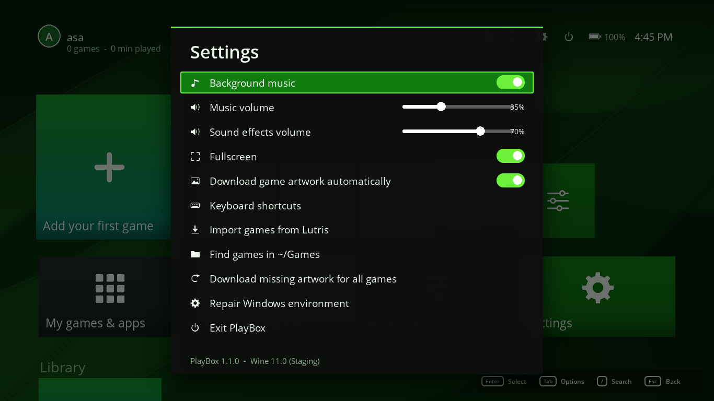
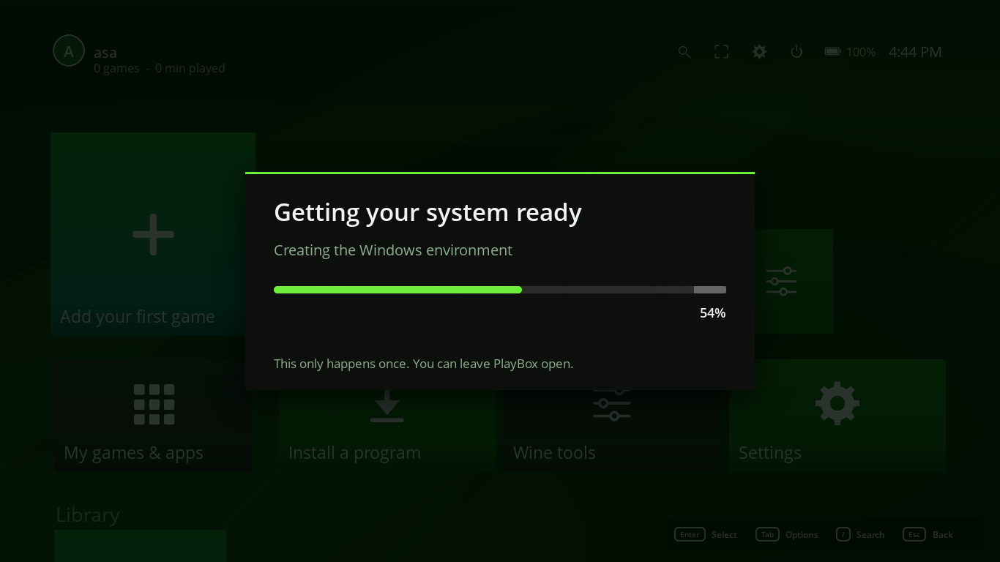

  

  
  
  

  <strong>راهی یکپارچه‌تر و ساده‌تر برای مدیریت بازی‌ها و برنامه‌های ویندوزی در لینوکس.</strong>

  <a href="README.md">English</a> · فارسی

---

## معرفی

**PlayBox** یک برنامه دسکتاپ با تمرکز بر گیمینگ است که بخش‌های مهم اجرای بازی‌ها و برنامه‌های ویندوزی در لینوکس را در یک رابط واحد جمع می‌کند.

ایده اصلی پروژه ساده است: کار با Wine و مدیریت بازی‌های ویندوزی نباید شبیه کنار هم گذاشتن چند ابزار جداگانه باشد. PlayBox تلاش می‌کند تجربه‌ای شبیه یک هاب گیمینگ ارائه دهد؛ جایی برای مدیریت کتابخانه، شروع نصب برنامه‌ها، دسترسی به ابزارهای Wine و مدیریت محیط ویندوز.

هدف، فراهم‌کردن محیطی سرراست‌تر برای اضافه‌کردن بازی‌ها، نصب برنامه‌های ویندوزی، مرتب‌سازی کتابخانه و دسترسی به ابزارهای موردنیاز است.

> **توضیح درباره محتوای مخزن:** این بسته در حال حاضر شامل مستندات پروژه، هویت بصری و تصاویر برنامه است. پیش از معرفی آن به‌عنوان مخزن کامل سورس، باید کد برنامه PlayBox و بسته‌های انتشار نیز به مخزن اضافه شوند.

## امکانات

<table>
  <tr>
    <td width="72" align="center"></td>
    <td><strong>کتابخانه بازی‌ها و برنامه‌ها</strong> بازی‌ها و برنامه‌های ویندوزی را در یک محل اضافه و مدیریت کن.</td>
  </tr>
  <tr>
    <td align="center"></td>
    <td><strong>نصب برنامه‌ها</strong> فرایند نصب برنامه‌ها و بازی‌های ویندوزی را مستقیماً از رابط PlayBox آغاز کن.</td>
  </tr>
  <tr>
    <td align="center"></td>
    <td><strong>ابزارهای Wine</strong> از بخش اختصاصی ابزارهای Wine و مدیریت محیط ویندوز استفاده کن.</td>
  </tr>
  <tr>
    <td align="center"></td>
    <td><strong>واردکردن کتابخانه Lutris</strong> بازی‌های موجود در Lutris را وارد کن تا مجبور نباشی کتابخانه‌ات را از ابتدا بسازی.</td>
  </tr>
  <tr>
    <td align="center"></td>
    <td><strong>دریافت خودکار کاور بازی‌ها</strong> دریافت خودکار artwork و پیدا کردن کاورهای گمشده بازی‌ها.</td>
  </tr>
  <tr>
    <td align="center"></td>
    <td><strong>تعمیر محیط ویندوز</strong> در صورت نیاز از گزینه تعمیر محیط ویندوز استفاده کن.</td>
  </tr>
  <tr>
    <td align="center"></td>
    <td><strong>تنظیم تجربه کاربری</strong> تنظیم موسیقی پس‌زمینه، صدای موسیقی و افکت‌ها، حالت تمام‌صفحه و میان‌برهای صفحه‌کلید.</td>
  </tr>
</table>

از دیگر گزینه‌های قابل مشاهده در رابط فعلی می‌توان به جست‌وجوی بازی‌ها در مسیر `~/Games`، دریافت کاورهای گمشده برای همه بازی‌ها و کتابخانه یکپارچه بازی‌ها و برنامه‌ها اشاره کرد.

## تصاویر برنامه

  <strong>داشبورد اصلی</strong> 
  

  <strong>تنظیمات</strong> 
  

  <strong>آماده‌سازی اولیه محیط ویندوز</strong> 
  

## نسخه فعلی

در اسکرین‌شات‌های این مخزن، نسخه **PlayBox 1.1.0** همراه با **Wine 11.0 (Staging)** نمایش داده شده است.

سازگاری هر بازی یا برنامه به خود آن، وابستگی‌ها، پیکربندی Wine، توزیع لینوکس و سخت‌افزار کاربر بستگی دارد. PlayBox تضمین نمی‌کند که تمام عناوین ویندوزی بدون مشکل اجرا شوند. بهتر است سازگاری هر عنوان در محیط موردنظر جداگانه بررسی شود.

## دریافت برنامه

برای مشاهده نسخه‌های منتشرشده و یادداشت‌های انتشار به صفحه [Releases](../../releases) مراجعه کن.

برای نصب، دستورالعمل‌ها و پیش‌نیازهای مخصوص همان بسته انتشار را دنبال کن. در حال حاضر فهرست رسمی و تأییدشده‌ای از توزیع‌های پشتیبانی‌شده در این مخزن اعلام نشده است؛ پس از آزمایش، می‌توان اطلاعات دقیق سازگاری را به مستندات اضافه کرد.

## شروع کار

در رابط فعلی چند مسیر اصلی در دسترس است:

1. با گزینه **Add your first game** ساخت کتابخانه را شروع کن.
2. برای آغاز نصب یک برنامه ویندوزی، **Install a program** را انتخاب کن.
3. برای انتقال بازی‌های موجود، از **Import games from Lutris** استفاده کن.
4. برای دسترسی به ابزارهای محیط ویندوز و گزینه‌های برنامه، وارد **Wine tools** یا **Settings** شو.

مراحل دقیق ممکن است با توجه به نسخه PlayBox و برنامه ویندوزی موردنظر متفاوت باشد.

## بازخورد و گزارش مشکل

PlayBox یک پروژه مستقل است و بازخوردهای کاربردی به بهترشدن آن کمک می‌کنند. برای گزارش باگ، اعلام تجربه سازگاری یا پیشنهاد قابلیت از [GitHub Issues](../../issues) استفاده کن.

برای اینکه بررسی مشکل ساده‌تر شود، این اطلاعات را بنویس:

- نسخه PlayBox و نسخه Wine.
- نام و نسخه توزیع لینوکس.
- نام بازی یا برنامه موردنظر.
- انتظار تو و اتفاقی که در عمل افتاده است.
- گزارش خطا یا لاگ مرتبط، پس از حذف اطلاعات شخصی و موارد محرمانه.

پیش از ساخت گزارش جدید، موضوعات موجود را بررسی کن.

## پیوندها

- **نسخه‌ها:** [دانلودها و یادداشت‌های انتشار](../../releases)
- **مسائل و پیشنهادها:** [GitHub Issues](../../issues)
- **راهنمای مشارکت:** [CONTRIBUTING.md](CONTRIBUTING.md)
- **English:** [Read the English README](README.md)

## اعتبار و استقلال پروژه

PlayBox از اکوسیستم گیمینگ لینوکس استفاده می‌کند و با آن تعامل دارد. **Wine** و **Lutris** پروژه‌هایی مستقل هستند؛ PlayBox نیز برنامه‌ای مستقل است و محصول رسمی Wine یا Lutris محسوب نمی‌شود.

- [Wine](https://www.winehq.org/)
- [Lutris](https://lutris.net/)

## مجوز

هنوز مجوزی به این مخزن اضافه نشده است. تا زمانی که صاحب پروژه مجوز مشخصی انتخاب و منتشر نکند، کد و محتوای پروژه باید **All Rights Reserved** در نظر گرفته شوند. بنابراین نباید فرض کرد که استفاده مجدد یا بازتوزیع آن آزاد است.

---

   
  <strong>PlayBox</strong> 
  یک محل برای مدیریت تجربه اجرای بازی‌ها و برنامه‌های ویندوزی در لینوکس.

