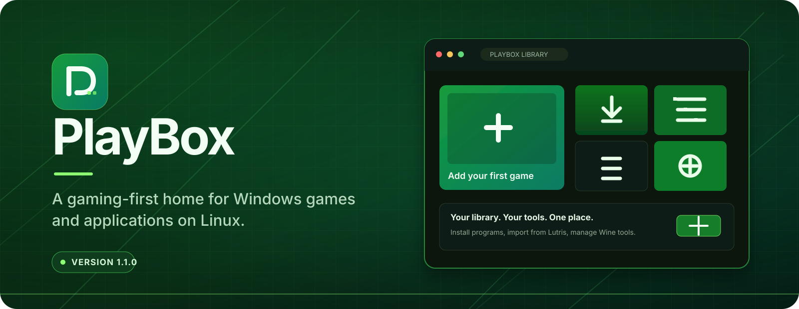
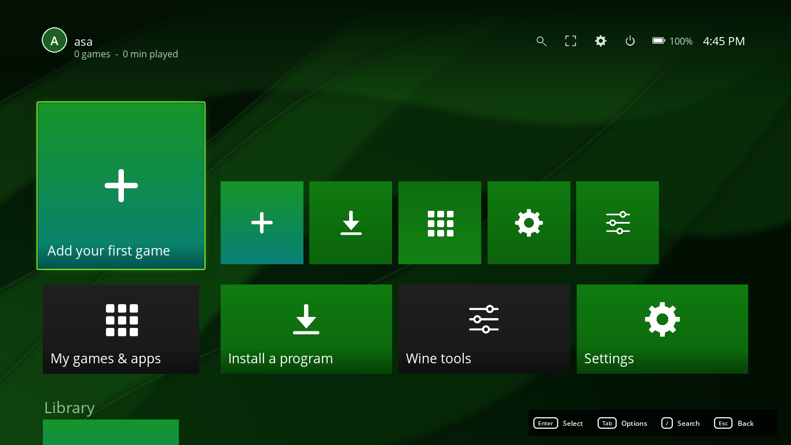
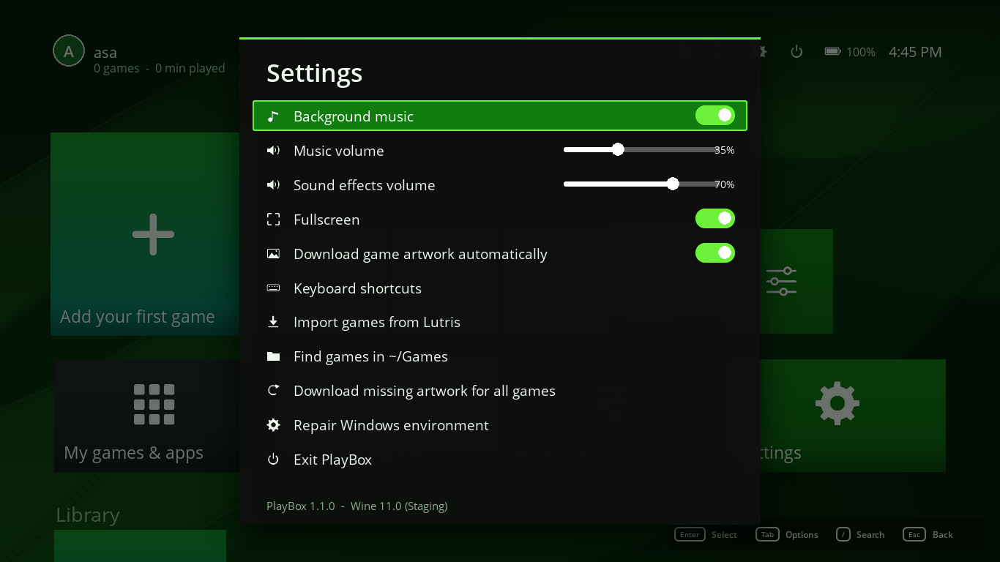
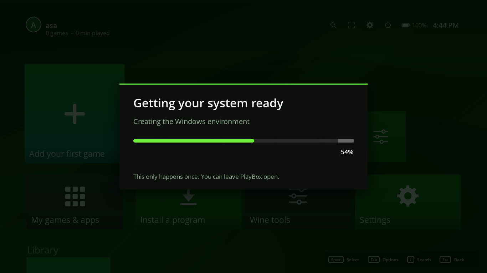

  

  
  
  

  <strong>A cleaner, more approachable way to manage Windows games and applications on Linux.</strong>

  <a href="#overview">Overview</a> ·
  <a href="#features">Features</a> ·
  <a href="#screenshots">Screenshots</a> ·
  <a href="#downloads">Downloads</a> ·
  <a href="#feedback">Feedback</a>

---

## Overview

**PlayBox** is a gaming-focused desktop application that brings common Windows-game and application workflows on Linux into one interface.

The project started with a simple idea: using Wine and managing Windows games should feel less like piecing together separate utilities and more like using a dedicated gaming hub. PlayBox combines a game library, program installation entry points, Wine tools, and library-management options in a single, visually consistent experience.

It is designed for people who want a more straightforward place to add games, install Windows programs, organize their library, and access the tools around their Wine environment.

## Features

<table>
  <tr>
    <td width="72" align="center"></td>
    <td><strong>Game and application library</strong> Add your Windows games and applications and keep them together in one place.</td>
  </tr>
  <tr>
    <td align="center"></td>
    <td><strong>Program installation</strong> Start installing Windows programs and games directly from the PlayBox interface.</td>
  </tr>
  <tr>
    <td align="center"></td>
    <td><strong>Wine tools</strong> Access Wine-related tools and Windows-environment management from a dedicated area.</td>
  </tr>
  <tr>
    <td align="center"></td>
    <td><strong>Lutris library import</strong> Import existing games from Lutris instead of rebuilding your library from scratch.</td>
  </tr>
  <tr>
    <td align="center"></td>
    <td><strong>Automatic game artwork</strong> Download artwork automatically and fetch missing artwork for games in your library.</td>
  </tr>
  <tr>
    <td align="center"></td>
    <td><strong>Windows-environment repair</strong> Use the repair option when the Windows environment needs attention.</td>
  </tr>
  <tr>
    <td align="center"></td>
    <td><strong>Personalized experience</strong> Configure background music, music and sound-effect volume, fullscreen mode, and keyboard shortcuts.</td>
  </tr>
</table>

Additional library actions visible in the current interface include finding games in `~/Games`, downloading missing artwork for all games, and browsing a combined games-and-apps library.

## Screenshots

  <strong>Main dashboard</strong> 
  

  <strong>Settings</strong> 
  

  <strong>First-run Windows environment setup</strong> 
  

## Current build

The screenshots show **PlayBox 1.1.0** with **Wine 11.0 (Staging)**.

Game compatibility depends on the individual game or application, its dependencies, the Wine configuration, the Linux distribution, and the user's hardware. PlayBox does not imply that every Windows title will run successfully. Compatibility information should be verified for each title and environment.

## Downloads

Check the [Releases](../../releases) page for available PlayBox builds and release notes.

Installation instructions and package-specific requirements should be followed from the documentation provided with the relevant release. No distribution-specific support matrix is claimed here; tested distributions and requirements can be documented as they are verified.

## How to get started

The current interface provides several entry points:

1. Use **Add your first game** to begin building a library.
2. Use **Install a program** to start a Windows application installation.
3. Use **Import games from Lutris** to bring an existing Lutris library into PlayBox.
4. Open **Wine tools** or **Settings** to access environment and application options.

The exact steps may vary by PlayBox build and by the Windows application being installed.

## Feedback

PlayBox is an independent project, and practical feedback is useful. Bug reports, compatibility notes, and thoughtful feature requests are welcome through [GitHub Issues](../../issues).

When reporting a problem, include the details that help reproduce it:

- PlayBox version and Wine version.
- Linux distribution and version.
- The game or application involved.
- What you expected to happen and what happened instead.
- Relevant logs or error messages, with personal information and secrets removed.

Please check existing issues before opening a new one.

## Project links

- **Releases:** [Available builds and release notes](../../releases)
- **Issues:** [Bug reports and feature requests](../../issues)
- **Contributing:** [Contribution guidelines](CONTRIBUTING.md)
- **فارسی:** [خواندن معرفی فارسی](README.fa.md)

## Credits and independence

PlayBox uses and integrates with the wider Linux gaming ecosystem. **Wine** and **Lutris** are separate projects; PlayBox is an independent application and is not an official Wine or Lutris product.

- [Wine](https://www.winehq.org/)
- [Lutris](https://lutris.net/)

## License

A license has not yet been specified in this repository. Until the project owner adds a license, the code and materials should be treated as **all rights reserved**. Do not assume that this project is open source or that redistribution is permitted.

---

   
  <strong>PlayBox</strong> 
  One place for your Windows gaming workflow on Linux.

